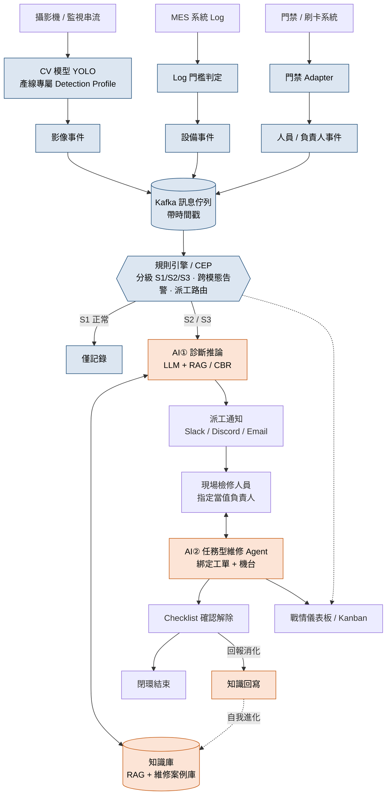

# 系統架構說明書 — AI 賦能伺服器機殼智慧產線

> 主題一｜AI × 智慧現場：全知辨識與即時響應
> 設計核心：**決策權分層** — 確定性事件交給規則（快路，約 95%），需要推理判斷的環節才交給 AI/Agent（慢路，約 5%）。

---

## 一、總覽

系統由上而下分為六層，資料從現場流入、經規則與 AI 處理後派工，最後在前端形成「偵測 → 診斷 → 派工 → 現場協作 → 回報 → 知識回寫」之自動化閉環。

| 層 | 名稱 | 性質 |
|---|---|---|
| L0 | 資料來源 Data Sources | 現場輸入 |
| L1 | 感測層 Sensing | 確定性（CV / 規則） |
| L2 | 資料管道 Data Pipeline | 事件匯流 |
| L3 | 快路 Fast Path（規則引擎 / CEP） | 確定性、可稽核、秒級 |
| L4 | 慢路 Slow Path（AI / Agent） | 需要判斷的 5% |
| L5 | 派工與互動 Dispatch & Interaction | 人機協作 |
| L6 | 前端與閉環 Frontend & Closed Loop | 呈現與回饋 |

---

## 二、各層元件

### L0 — 資料來源
- **攝影機 / 監視串流**：各產線現場影像。
- **MES 系統**：機台運作文字 Log。
- **門禁 / 刷卡系統**：人員進出與機台負責人資料。

### L1 — 感測層（確定性，不用 LLM）
- **CV 模型（YOLO）**：影像 → 影像事件。**產線專屬**：沖壓段 / 銲接段 / 組裝段各自的 Detection Profile。
  - 銲接段注意：火花為正常作業現象，異常定義為「非銲接工位 ROI 之煙霧／火光」或「機器人停止後仍有煙霧」。
- **Log 門檻判定**：MES Log → 設備事件（Idle、馬達高溫、異常碼）。
- **門禁 Adapter**：門禁資料 → 人員 / 負責人事件。

### L2 — 資料管道
- **Kafka 訊息佇列**：匯流上述三類事件，所有事件帶時間戳。
- **Topics**：`vision.events`、`mes.logs`、`access.events`、`alerts`、`tasks`。

### L3 — 快路（規則引擎 / CEP）
- **嚴重度分級**：S1 正常（綠燈）/ S2 警示（黃燈）/ S3 異常（紅燈）。
- **已知跨模態組合告警**（可稽核規則）：
  - 影像 Idle ↔ Log 顯示運轉 → 不一致 → 感測器 / Log 失準告警。
  - 影像 Idle + Log Idle 持續 N 分鐘 → 確認真閒置。
  - Log 高溫 + 影像無人 → 升級 S3。
- **派工路由**：依當天班表／生管人員配置名單（班別 × 產線 × 人員 × 職位）指派：S2 工安 → 班長；S2 設備 → 當班技術員；S3 → 該線當班職位最高者 + 技術員。門禁確認是否在廠，不在則改派；N 分鐘無人接單則逐級升級（技術員 → 班長 → 組長 → 課長）。
- **分流（事件類別 × 嚴重度）**：
  - `S1 → 僅記錄`
  - 工安類（PPE、闖入）：`S2 → 派工 + SOP 查表`；`S3 → 緊急通報 + 派工`（不啟動 LLM）
  - 設備類（卡料、閒置、高溫、Log 失準）：`S2 → 派工 + AI 診斷`；`S3 → 緊急通報 + 派工 + AI 診斷（同步、不阻塞通報）`

### L3.5 — 直覺層（Jev 1.14 via OpenRouter，System 1，文字約 0.2 秒）
- 規則判不了或需要語意判斷的事件 → **Jev** 一次請求同時回答：事件類別（Choice）、是否誤報（Noul）、嚴重度（Score，只能升級不能降級）、根因 top-k 機率（Choice，選項來自故障模式目錄）。
- 依信心度分流：高信心 → 直接派工並附上根因機率；低信心 → 交給 L4 LLM 深入診斷。
- **看關鍵幀**（Jev 1.14 支援圖片＋Box）：V1 確認 YOLO 的 PPE 告警是否誤報；V2 零樣本判斷卡料、煙霧並框出位置（不需訓練資料）。YOLO 在本機逐幀跑，Jev 每支攝影機最多每 5 秒看一張，觸發時加送。
- 只送去識別化的事件代碼與機台 ROI 裁切圖；人員圖先模糊臉部。Jev 逾時則退回規則＋YOLO 照常派工。詳見 `Jev整合規劃.md`。

### L4 — 慢路（AI，只處理需要判斷的 5%）
- 快思慢想：Jev 負責快速判斷（System 1），LLM 只負責產生文字與對話（System 2）。
- **AI① 診斷推論（LLM + RAG / CBR）**：異常事件 → top-k 可能根因 + 處置建議 + SOP。
- **知識庫（向量資料庫 RAG + 維修案例庫）**：供 AI① 檢索；接收結案回寫。
- **AI② 任務型維修 Agent**：綁定單一工單 + 機台，與現場人員雙向對話（問答 / 引導排查 / 動態長尾排查）。每一步建議先經 Jev 安全把關（是否需要 LOTO、是否進入運轉區、是否涉及高壓），命中就要求主管確認。
- **LLM 選型（定案）**：**DeepSeek V4.1 Flash**，Demo 階段透過 **Ollama Cloud** 呼叫（`https://ollama.com/api/chat`，model `deepseek-v4.1-flash`），AI① 說明文字與 AI② 維修 Agent 共用。
  - 2026-10-20 實測：繁中條列回覆約 300 token，總耗時 1.3 秒。
  - 地端敘事：Ollama 雲端與本機是同一套 API，正式導入時把 host 換成廠內 Ollama 主機即可，程式不用改（前提是該模型提供開放權重 🔬）。
  - 正式環境鎖定版本標籤（目前有 `deepseek-v4.1-flash:1017`）。

### L5 — 派工與互動
- **派工通知**：AI① 建議 → Slack / Discord / Email → 現場檢修人員（指定當值負責人）。
- **現場檢修人員**：到場後與 AI② 維修 Agent 互動。

### L6 — 前端與閉環
- **戰情儀表板（Dashboard）**：機台健康度、稼動率、告警分佈。
- **任務看板（Kanban）**：待處理 / 處理中 / 已解除。
- **Checklist 確認解除**：逐項勾選 → 閉環結束。
- **知識回寫**：結案時 Jev 先檢查回報是否完整並做根因歸類，AI② 再把回報整理成結構化知識 → 寫回知識庫（自我進化回饋）。

---

## 三、資料流（節點與箭頭）

```
攝影機 ──► CV模型(YOLO) ──► 影像事件 ─┐
MES ─────► Log門檻判定 ───► 設備事件 ─┼─► Kafka ──► 規則引擎 / CEP
門禁 ────► 門禁Adapter ───► 人員事件 ─┘                  │
                                                         │ (S1: 僅記錄)
                                                         │ (S2/S3 ▼)
                                          AI① 診斷推論(LLM+RAG/CBR) ◄──► 知識庫(RAG+案例庫)
                                                         │
                                                         ▼
                                          派工通知(Slack/Discord/Email)
                                                         │
                                                         ▼
                                          現場檢修人員 ◄──► AI② 任務型維修Agent
                                                         │
                                                         ▼
                                          Checklist確認解除 ──► 閉環結束
                                                         │
                                       戰情儀表板 / Kanban ◄┘
                                                         │
                                  知識回寫 ───────────────┘──► 知識庫（回饋：自我進化）
```

---

## 四、Mermaid 圖（可直接渲染）



---

## 五、繪圖重點提示

- **快路（藍）vs 慢路（橘）** 用顏色區分，凸顯「決策權分層」。
- **CEP 後的菱形分流**：`S1 → 記錄`、`S2/S3 → AI`，強調 AI 只處理 5%。
- **知識回寫 → 知識庫** 用**虛線回饋箭頭**，表示自我進化閉環。
- 三個資料來源（影像 / Log / 門禁）並列進 Kafka，凸顯**跨模態**與**負責人追溯**。
